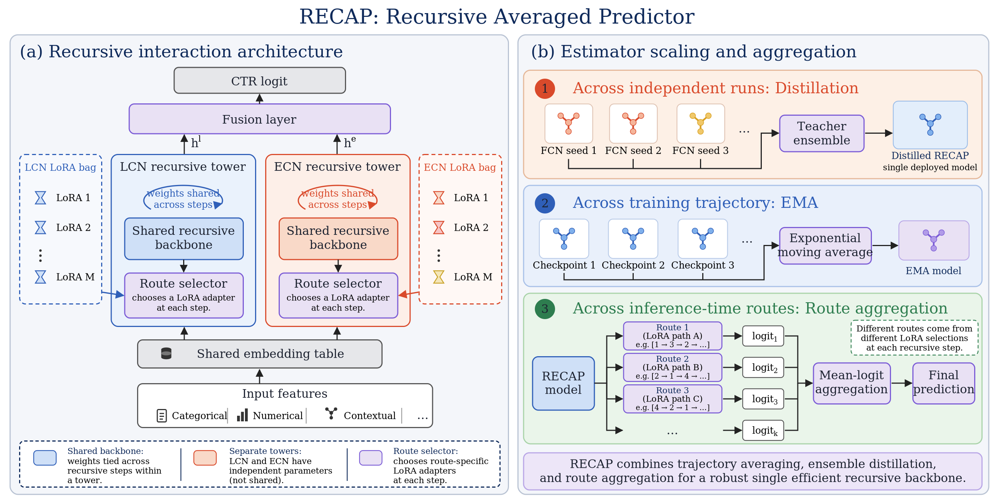
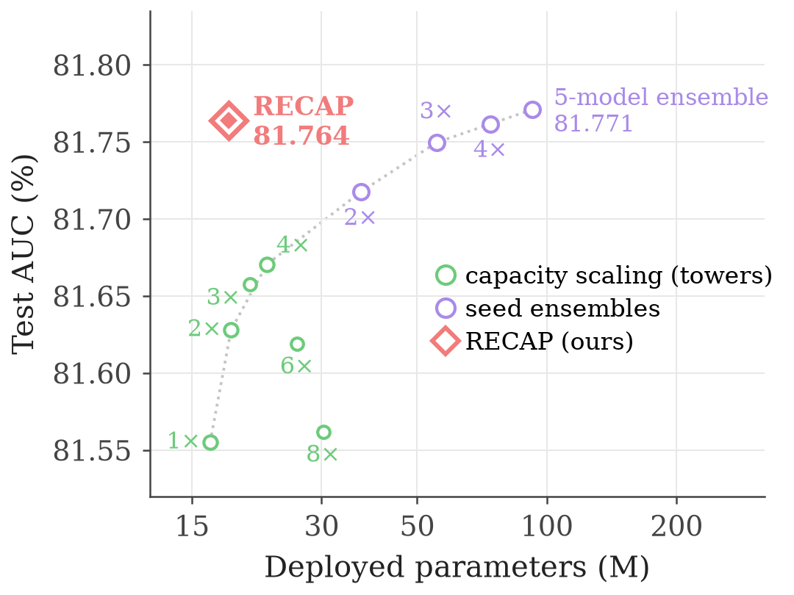
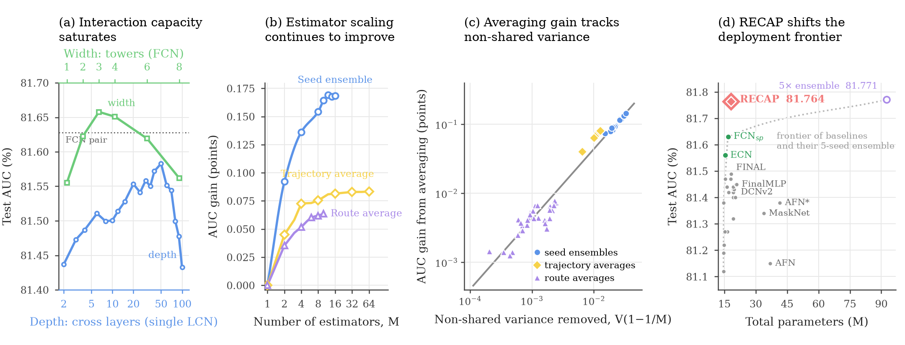
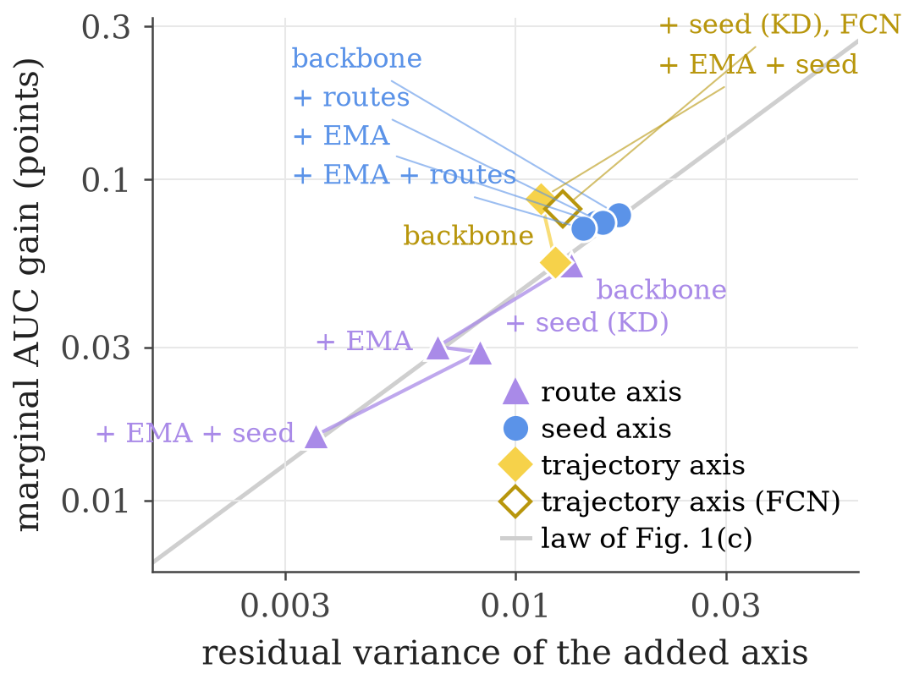

# Beyond Interaction Capacity: Estimator Scaling with Recursive Models for CTR Prediction

*Figure 2. RECAP architecture and multi-level estimator scaling.*

## Main results

Test logloss and test AUC (%) on five public CTR benchmarks (Table 1 of the paper). RECAP is the run `RRT_Distillation_EMA`
of each dataset; on ML-1M it is the tuned-teacher run `RRT_Distillation_EMA_tuned_ml1m` with inference-time route aggregation.

| Model | Avazu | Criteo | ML-1M | KDD12 | KKBox |
|---|---|---|---|---|---|
| FCN (Li et al., 2026) | 0.3702 / 79.66 | 0.4358 / 81.62 | 0.3001 / 90.74 | 0.1494 / 80.86 | 0.4746 / 85.72 |
| QNN (Li et al., 2025) | 0.3712 / 79.47 | 0.4358 / 81.63 | 0.2960 / 90.87 | 0.1506 / 80.82 | 0.4730 / 85.76 |
| **RECAP (ours)** | **0.3702 / 79.92** | **0.4355 / 81.76** | **0.2951 / 90.88** | **0.1494 / 81.41** | **0.4669 / 86.06** |

Exact values of the RECAP cells as stored in `outputs/<run>/result.json`: Avazu 79.922 / 0.37027, Criteo 81.765 / 0.43554,
ML-1M 90.880 / 0.29507 (route-fused, calibrated), KDD12 81.412 / 0.14946, KKBox 86.064 / 0.46694. The QNN cells on Avazu and
KDD12 are our runs of the authors' QNN_T26 (`src/ranking_ctr/qnn.py`; `QNN_r5_avazu` 79.474 / 0.3712, `QNN_r5_kdd12`
80.820 / 0.1506, width factor selected on validation); the other QNN cells are the values reported by the QNN paper. Of the FCN
row, the Criteo, KDD12 and KKBox AUCs coincide with our FCN_sp reproductions (`FCN_Baseline` 81.625, `FCN_Baseline_kdd12`
80.863, `FCN_Baseline_kkbox` 85.727); the remaining FCN cells and all other baselines are quoted from the FCN paper.

*Figure 4. RECAP improves the deployment performance–parameter frontier on Criteo: tower scaling saturates, seed ensembles
keep improving at linear deployment cost, and RECAP reaches near five-model-ensemble accuracy at a single-model budget.*

## Diagnostic analysis on Criteo

*Figure 1. (a) Interaction capacity saturates with depth and width. (b) Estimator scaling keeps improving: seed ensembles
(to 16 models), trajectory averages and route averages. (c) Averaging gains track the non-shared variance removed.
(d) RECAP shifts the accuracy–parameter frontier against the published baselines.*

### Ablation of the estimator-scaling axes on the recursive backbone (Table 2)

| Model | EMA | KD | Routes | AUC | run |
|---|---|---|---|---|---|
| Recursive backbone | – | – | – | 81.59 | campaign `mt2_rdrop_drop1` (81.594) |
| + trajectory scaling | ✓ | – | – | 81.65 | campaign `w18_cosema` (81.647) |
| + cross-run scaling | – | ✓ | – | 81.68 | campaign `mt2_rdrop_drop1_fkd` (81.679); package `RRT_Distillation` 81.683 |
| + route scaling | – | – | ✓ | 81.61 | route fusion of the backbone (81.610) |
| RECAP | ✓ | ✓ | ✓ | 81.76 | `RRT_Distillation_EMA` (81.765) |

### Estimator scaling on the FCN backbone (Table 3)

| Model | EMA | KD | AUC | run |
|---|---|---|---|---|
| FCN | – | – | 81.62 | `FCN_Baseline` (81.625) |
| + trajectory scaling | ✓ | – | 81.67 | `FCN_EMA` (81.669) |
| + cross-run scaling | – | ✓ | 81.69 | `FCN_Distillation` (81.694) |
| + cross-run + trajectory scaling | ✓ | ✓ | 81.74 | `FCN_Distillation_EMA` (81.741) |

*Figure 3. The marginal gain of adding an estimator axis tracks the residual non-shared variance left by the axes already
applied, across the trajectory, seed and route axes.*

## Hyperparameter sensitivity (Table 4)

One knob changed per run from the RECAP default on Criteo (EMA decay 0.9995, KD weight 1, 5 teacher seeds, LoRA rank 96,
8 route adapters); test AUC (%) / calibrated test logloss. Runs `HP_*`; the LaTeX table is `figures/hp_table.tex`.

| Hyperparameter | value: AUC / logloss |
|---|---|
| EMA decay | 0.99: 81.735 / 0.43487, 0.995: 81.744 / 0.43482, 0.999: 81.760 / 0.43461, **0.9995: 81.765 / 0.43456**, 0.9999: 81.770 / 0.43450 |
| KD weight | 0: 81.665 / 0.43535, 0.25: 81.743 / 0.43461, 0.5: 81.766 / 0.43443, **1: 81.765 / 0.43456**, 2: 81.763 / 0.43454 |
| Teacher seeds | 1: 81.704 / 0.43502, 2: 81.744 / 0.43478, 3: 81.756 / 0.43469, **5: 81.765 / 0.43456**, 8: 81.768 / 0.43454 |
| LoRA rank | 24: 81.763 / 0.43459, 48: 81.765 / 0.43444, **96: 81.765 / 0.43456**, 192: 81.767 / 0.43444 |
| Route adapters | 2: 81.759 / 0.43452, 4: 81.767 / 0.43448, **8: 81.765 / 0.43456**, 16: 81.764 / 0.43444 |

## Acknowledgement
This implementation is based on FuxiCTR, BARS and FCN. Thanks for their sharing and contribution.

FCN: https://github.com/salmon1802/FCN \
BARS: https://github.com/openbenchmark \
FuxiCTR: https://github.com/xue-pai/FuxiCTR